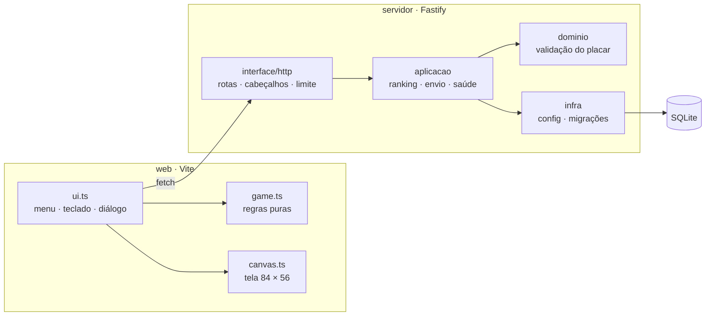

<!-- markdownlint-disable MD033 MD041 -->
<div align="center">

<a href="https://tsuru.frontzap.com.br/snake-3310/">
  
</a>

# Snake 3310

**O jogo da cobrinha clássico, de volta ao navegador.**

Inspirado no Nokia 3310, com teclado numérico na tela, controles por teclado e toque, pausa e ranking público.<br>
TypeScript, Node e SQLite leve, em uma única imagem no Tsuru.

<br>

[](package.json)
[](https://github.com/BrunodosSantosVaz/snake-3310/actions/workflows/bb-ci.yml)
[](https://github.com/BrunodosSantosVaz/snake-3310/actions/workflows/bb-codeql.yml)
[](LICENSE)
<br>
[](tsconfig.json)
[](package.json)
[](https://fastify.dev)
[](src/infra/database)
[](Dockerfile)

<br>

<a href="https://tsuru.frontzap.com.br/snake-3310/"></a>
<a href="https://tsuru.frontzap.com.br/snake-3310-hom/"></a>
<a href="https://github.com/BrunodosSantosVaz/snake-3310/wiki"></a>
<a href="https://github.com/BrunodosSantosVaz/snake-3310/discussions"></a>

</div>

<!-- Captura de tela: adicione uma imagem real do jogo em docs/design/screenshot.png e descomente.
<p align="center">
  
</p>
-->

<br>

<details>
<summary><b>Sumário</b></summary>

- [Destaques](#-destaques)
- [Como jogar](#-como-jogar)
- [Regras](#-regras)
- [Ranking público](#-ranking-público)
- [API](#-api)
- [Arquitetura](#-arquitetura)
- [Desenvolvimento](#-desenvolvimento)
- [Deploy](#-deploy)
- [Design](#-design)
- [Documentação](#-documentação)
- [Contribuindo](#-contribuindo)
- [Licença](#-licença)

</details>

## 🐍 Destaques

<table>
<tr>
<td width="33%" valign="top">

### 📱 Fiel ao original
Grade lógica de 21 × 13, como o Snake II do 3310. Tela verde, pixels escuros e teclado numérico clicável.

</td>
<td width="33%" valign="top">

### ⌨️ Teclado ou toque
Jogue com as teclas do celular na tela, com setas, WASD ou o teclado numérico. Áreas de toque de no mínimo 44 px.

</td>
<td width="33%" valign="top">

### 🏆 Ranking público
Envie seu placar com um apelido e dispute os maiores pontos. Validação, filtro de apelidos e limite de envios no servidor.

</td>
</tr>
</table>

## 🎮 Como jogar

<a href="https://tsuru.frontzap.com.br/snake-3310/"></a>

| Ação | Teclas do aparelho | Teclado do computador |
|---|---|---|
| Navegar no menu | <kbd>2</kbd> <kbd>8</kbd> | <kbd>↑</kbd> <kbd>↓</kbd> · <kbd>W</kbd> <kbd>S</kbd> |
| Escolher | <kbd>OK</kbd> | <kbd>Enter</kbd> |
| Mover a cobra | <kbd>2</kbd> <kbd>4</kbd> <kbd>6</kbd> <kbd>8</kbd> | Setas · <kbd>W</kbd> <kbd>A</kbd> <kbd>S</kbd> <kbd>D</kbd> |
| Pausar e continuar | <kbd>5</kbd> | <kbd>Espaço</kbd> |
| Voltar | <kbd>C</kbd> | <kbd>Esc</kbd> |

## 📏 Regras

- A cobra começa com 3 segmentos e anda um passo a cada 180 ms.
- Cada comida vale **7 pontos**. A pontuação máxima é **1.890**.
- Bater na borda ou no próprio corpo encerra a partida.
- A comida nunca aparece sobre a cobra. Ocupar a grade inteira também encerra o jogo.

## 🏆 Ranking público

Ao fim da partida, informe um apelido para registrar o placar.

| Regra | Valor |
|---|---|
| Apelido | 3 a 12 letras ou números Unicode |
| Pontos | Inteiro de 0 a 1.890, múltiplo de 7 |
| Vocabulário ofensivo | Recusado, comparado sem caixa e sem acentos |
| Limite | 5 tentativas por IP a cada 60 segundos |
| Ordem | Maior pontuação primeiro. Empates pelo envio mais antigo |

> [!NOTE]
> O ranking não tem autenticação nem prova criptográfica da partida. É um placar casual.

## 🔌 API

Especificação completa em [`docs/api/openapi.yaml`](docs/api/openapi.yaml) (OpenAPI 3.1). Erros seguem `application/problem+json`.

| Método | Rota | Descrição |
|---|---|---|
|  | `/api/health` | O processo HTTP está vivo |
|  | `/api/ready` | O banco responde à verificação |
|  | `/api/placares` | Os dez maiores placares públicos |
|  | `/api/placares` | Valida e registra um placar |

<details>
<summary><b>Exemplo de envio</b></summary>

```bash
curl -X POST https://tsuru.frontzap.com.br/snake-3310/api/placares \
  -H 'Content-Type: application/json' \
  -d '{"nickname":"cobrinha","points":147}'
```

| Status | Quando |
|---|---|
| `201` | Placar gravado |
| `400` | Apelido, pontos ou campos inválidos |
| `413` | Corpo acima de 1024 bytes |
| `415` | Tipo de conteúdo não suportado |
| `429` | Limite de tentativas atingido, com `Retry-After` |

</details>

## 🏛️ Arquitetura

Camadas separadas e verificadas por `dependency-cruiser`.



| Camada | Pasta | Responsabilidade |
|---|---|---|
| Web | [`src/web`](src/web) | Interface do aparelho, motor do jogo e desenho no canvas |
| Interface | [`src/interface`](src/interface) | Servidor HTTP, cabeçalhos de segurança, limite de envios e migrações |
| Aplicação | [`src/aplicacao`](src/aplicacao) | Casos de uso: ranking, envio de placar e saúde |
| Domínio | [`src/dominio`](src/dominio) | Regras do ranking e validação do placar |
| Infra | [`src/infra`](src/infra) | Configuração por ambiente e repositório SQLite |

## 🛠️ Desenvolvimento

**Pré-requisitos:** Node.js 24.

```bash
git clone https://github.com/BrunodosSantosVaz/snake-3310.git
cd snake-3310
npm ci
npm run dev
```

| Comando | O que faz |
|---|---|
| `npm run dev` | Interface com recarga automática (Vite) |
| `npm run build` | Compila servidor e interface |
| `npm start` | Inicia o servidor compilado |
| `npm run migrar` | Aplica as migrações do banco |
| `npm test` | Testes unitários e de integração (Vitest) |
| `npm run test:acceptance` | Testes de aceite |
| `npm run test:coverage` | Cobertura (mínimo de 80%) |
| `npm run test:architecture` | Regras de dependência entre camadas |
| `npm run lint` · `npm run typecheck` | Lint, design e tipos |

<details>
<summary><b>Variáveis de ambiente</b></summary>

| Variável | Padrão | Uso |
|---|---|---|
| `PORT` | `8080` | Porta HTTP (`8888` na imagem) |
| `BASE_PATH` | vazio | Prefixo das rotas, como `/snake-3310` |
| `SQLITE_PATH` | `data/snake-3310.sqlite` | Arquivo durável do banco, fora de `dist` (`/data/scores.sqlite` na imagem) |
| `WEB_DIR` | `dist/web` | Arquivos estáticos da interface |
| `TRUSTED_PROXY_IPS` | vazio | Proxies confiáveis para identificar o IP do cliente |
| `NODE_ENV` | — | `production` em produção |

</details>

## 🚢 Deploy

Uma imagem imutável construída uma vez e promovida por digest entre homologação e produção.

| Item | Valor |
|---|---|
| Imagem | `ghcr.io/brunodossantosvaz/snake-3310` |
| Plataforma | `linux/arm64` |
| Base | `node:24.18.1-alpine`, fixada por digest |
| Execução | Usuário `node`, volume `/data`, sem npm na imagem final |
| Saúde | `HEALTHCHECK` em `/api/ready` |
| Ambientes | [Homologação](https://tsuru.frontzap.com.br/snake-3310-hom/) · [Produção](https://tsuru.frontzap.com.br/snake-3310/) |

```bash
docker build -t snake-3310 .
docker run -p 8888:8888 -v snake-data:/data snake-3310
```

## 🎨 Design

| Token | Cor | Uso |
|---|:-:|---|
| Fundo |  `#0E1A33` | Página atrás do aparelho |
| Aparelho |  `#2B4C8C` | Corpo azul do celular |
| Tela |  `#C7F0D8` | Tela verde-azulada |
| Pixel |  `#43523D` | Cobra, comida e texto da tela |
| Primária |  `#8FD3FF` | Ação principal e links |
| Foco |  `#FFD166` | Anel de foco |

Todos os tokens estão em [`docs/design/tokens.css`](docs/design/tokens.css). Identidade e Social preview na [Wiki → Design](https://github.com/BrunodosSantosVaz/snake-3310/wiki/Design).

## 📚 Documentação

A documentação oficial está na **[Wiki](https://github.com/BrunodosSantosVaz/snake-3310/wiki)**.

| | |
|---|---|
| 🚀 [Instalação e uso](https://github.com/BrunodosSantosVaz/snake-3310/wiki/Guia-de-inicio) | ✨ [Funcionalidades e limites](https://github.com/BrunodosSantosVaz/snake-3310/wiki/Funcionalidades) |
| 🏛️ [Arquitetura e referência](https://github.com/BrunodosSantosVaz/snake-3310/wiki/Referencia) | 🔧 [Operação e recuperação](https://github.com/BrunodosSantosVaz/snake-3310/wiki/Operacao) |
| 🔗 [Requisitos e cobertura documental](https://github.com/BrunodosSantosVaz/snake-3310/wiki/Rastreabilidade) | 👋 [Boas-vindas da IA](https://github.com/BrunodosSantosVaz/snake-3310/discussions/78) |

**Painéis públicos:** [Planejamento](https://github.com/users/BrunodosSantosVaz/projects/25) · [Execução](https://github.com/users/BrunodosSantosVaz/projects/26) · [Bugs](https://github.com/users/BrunodosSantosVaz/projects/27). Edição exige permissão explícita.

## 🤝 Contribuindo

Construído com o framework [Big Bang](https://github.com/BrunodosSantosVaz/big-bang) 2.0.1, no modo **Flash**.

1. Relate bugs e ideias nas [issues](https://github.com/BrunodosSantosVaz/snake-3310/issues). Dúvidas vão para [Discussions](https://github.com/BrunodosSantosVaz/snake-3310/discussions).
2. Trabalhe numa branch própria e preserve os testes de aceite.
3. Envie o PR com `Refs #n`, descrição, evidências e a Wiki atualizada.

Veja o [guia de contribuição](CONTRIBUTING.md), a [política de segurança](SECURITY.md) e o [código de conduta](CODE_OF_CONDUCT.md).

## 📄 Licença

Distribuído sob a licença [MIT](LICENSE). Projeto de fã, sem vínculo com a Nokia.

<div align="center">

<br>


<sub>Por <a href="https://github.com/BrunodosSantosVaz">Bruno dos Santos Vaz</a></sub>

<br><br>

<a href="https://star-history.com/#BrunodosSantosVaz/snake-3310&Date">
  
</a>

<br>

<sub>Bateu seu recorde? Deixe uma ⭐ no repositório.</sub>

</div>
